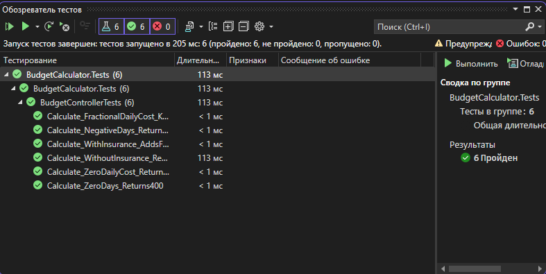
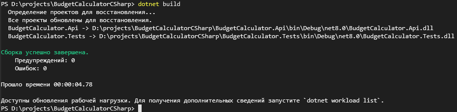
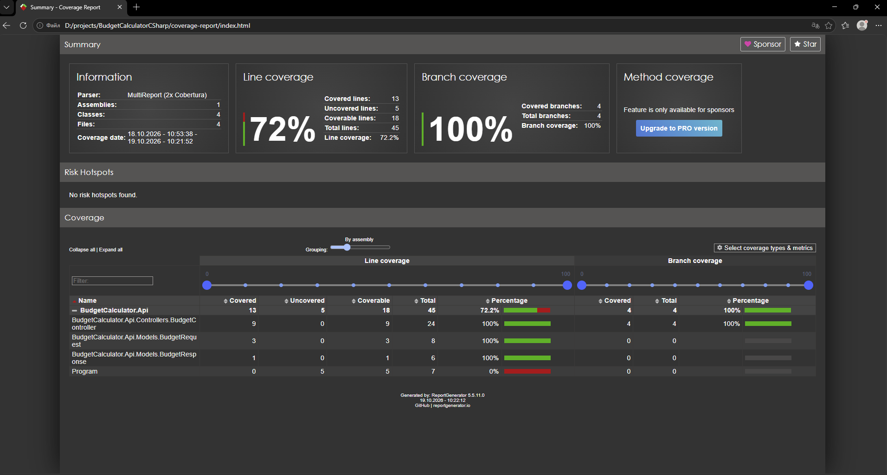

# Калькулятор бюджета на C#

Проект сделан на ASP.NET Core, тесты написал на xUnit.

## Что использовал

- C# / .NET 8
- ASP.NET Core
- xUnit
- Coverlet

## Тестирование

Написал 6 тестов:

1. Расчёт без страховки.
2. Расчёт со страховкой.
3. Отрицательное количество дней.
4. Нулевая стоимость дня.
5. Расчёт дробных сумм.
6. Нулевое количество дней.

В исходном примере страховка рассчитывалась неправильно. Вместо умножения суммы на 5 исправил на 1.05m, чтобы добавлялось 5%.

## Запуск

Запуск тестов:

```bash
dotnet test
```

Проверка покрытия:

```bash
dotnet test --collect:"XPlat Code Coverage"
```

Результат сохраняется в папке `TestResults`.


## Скрины

### Тесты

Все 6 тестов прошли успешно.



### Сборка проекта

Проект собирается без ошибок и предупреждений.



### Покрытие кода

Проверил покрытие через Coverlet и ReportGenerator. У контроллера покрытие строк и веток — 100%.



## Результат

Все 6 тестов проходят успешно. Покрытие веток — 100%.
